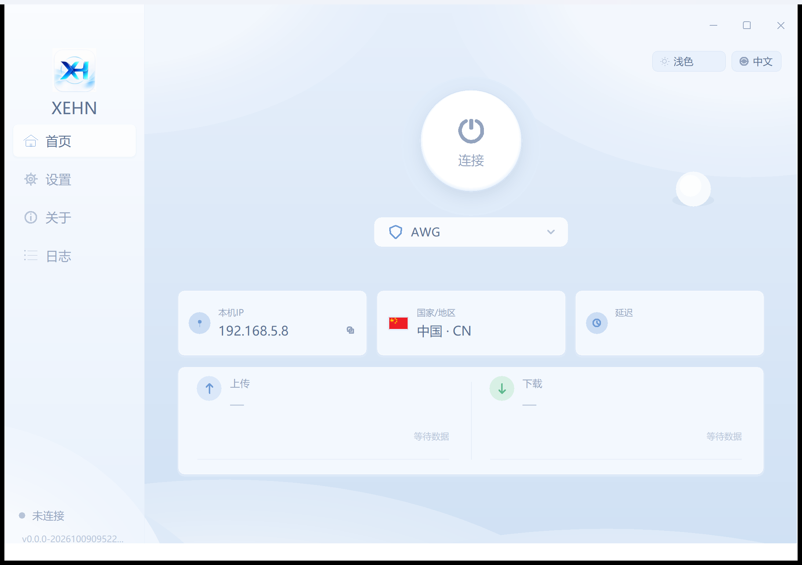
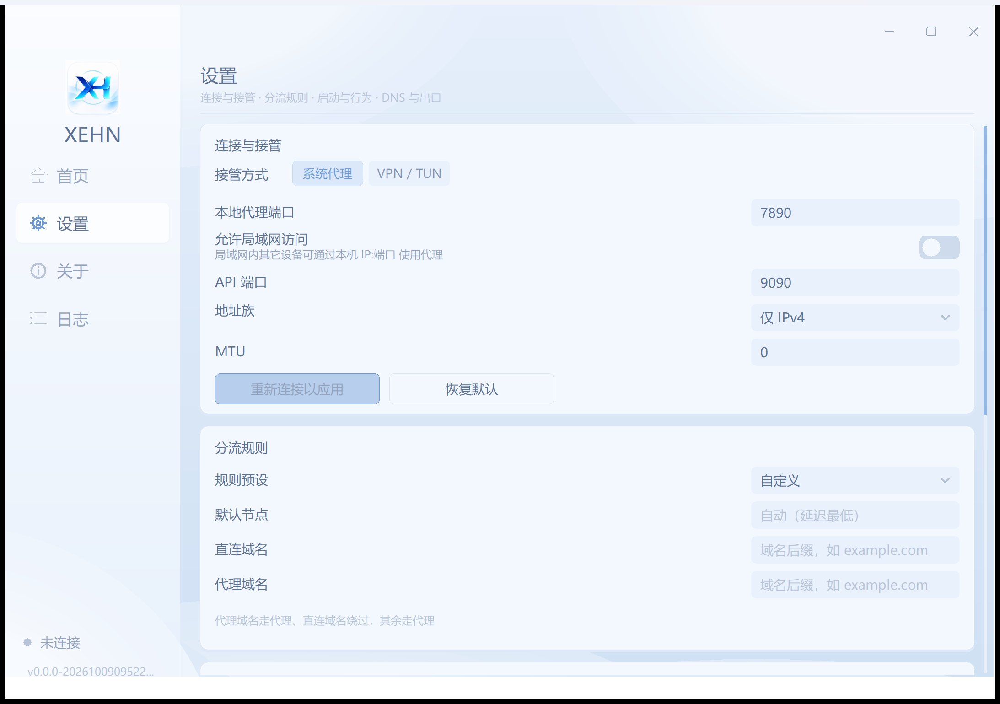
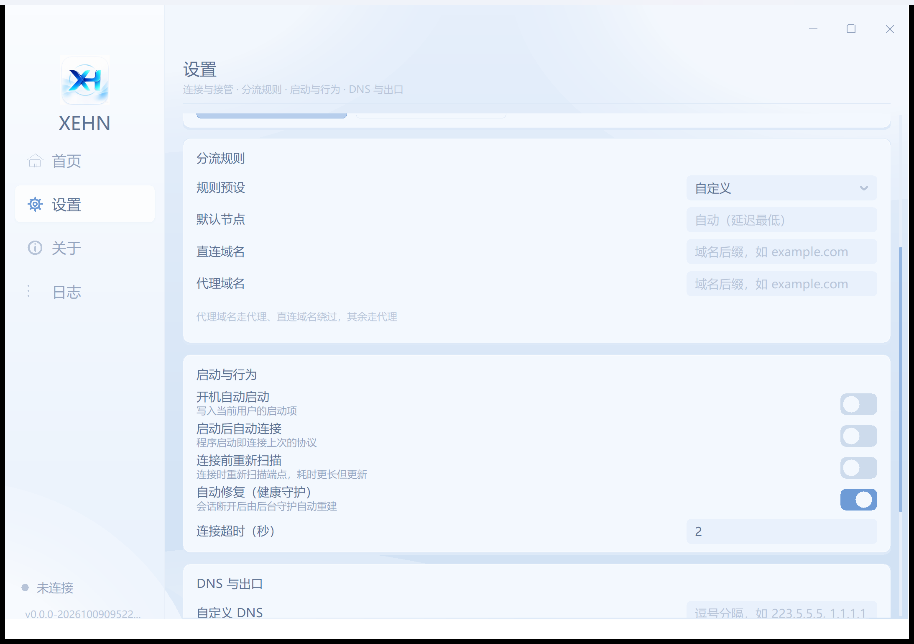
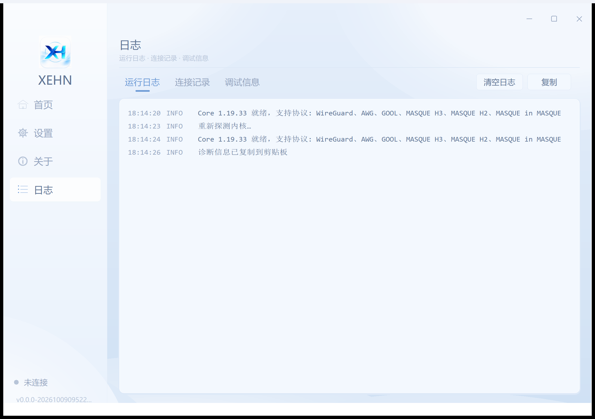
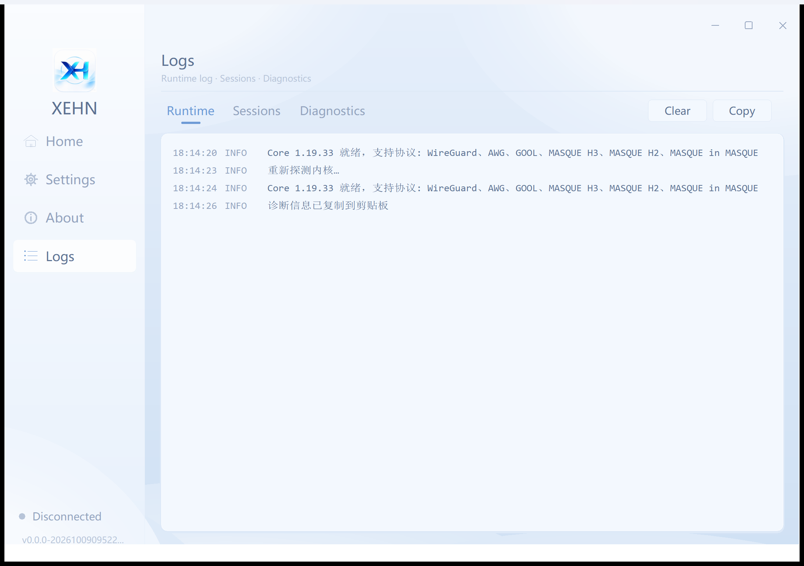

# VEGSH

English | [中文](README.zh-CN.md)

A Windows-first Cloudflare WARP client that scans for working endpoints and connects through them with one click. It combines the scanning engine from [vernette/warpscout](https://github.com/vernette/warpscout) with an embedded [mihomo](https://github.com/MetaCubeX/mihomo) core for actual traffic routing.

> **Notice**: This software is open source and free for learning and communication purposes only. Commercial sale is prohibited. The program only configures an encrypted tunnel on the local machine; it does not provide or proxy any server resources.

## Features

| Capability | Status |
|---|---|
| WARP endpoint scan (2-phase probe + tunnel verification) | Supported (warpscout engine) |
| Account register / rotate | Supported |
| AmneziaWG (AWG) | Supported — `amneziawg-go` userspace scan + mihomo `amnezia-wg-option` routing |
| WireGuard | Supported — mihomo `type: wireguard` |
| MASQUE / MASQUE-H2 | Supported — mihomo `type: masque` / `network: h2` |
| WARP-in-WARP (nested) | Supported — mihomo `dialer-proxy` chains |
| Psiphon exit (base protocol + Psiphon) | Supported — `psiphon.exe` sidecar over localhost SOCKS |
| OpenVPN exit (VPN Gate relay) | Supported — `--openvpn` via mihomo |
| Exit IP / latency / country display | Supported |
| Scan result + account cache (TTL) | Supported — `internal/cache` |
| System proxy mode (default) | Supported — WinINET registry + `InternetSetOption` notify |
| TUN global mode (optional) | Supported — mihomo `tun:` (requires Administrator; wintun embedded) |
| Native GUI (double-click portable) | Supported — Windows native window (lxn/walk), light/dark theme, 中文/English |
| Core separation / update | Supported — `core/mihomo.exe` managed as a plain file |
| Portable ZIP layout | Supported — `pack.ps1` assembles a v2rayN-style package |

## Quick Start (Portable)

1. Unzip the package into any writable directory.
2. Double-click `vegsh.exe` — the native GUI window opens.
3. Click **Connect**. On first run, VEGSH automatically registers a WARP account and scans for the best endpoint.

The ZIP is assembled from a clean staging tree and does **not** include `warpscout-account.json`, state, settings, caches, or logs. A fresh device registers its own WARP account on first connect/scan. Do not copy an old `warpscout-account.json` to another machine unless you intentionally want to reuse that device identity.

### Portable Layout

```
VEGSH\
├── vegsh.exe             # Single program file: double-click opens GUI; CLI with args
├── core\
│   ├── mihomo.exe        # Clash core (replaceable independently)
│   ├── psiphon.exe       # Optional: Psiphon exit sidecar (GPL-3.0)
│   ├── client.config     # Optional: official Psiphon credentials (required with psiphon.exe)
│   ├── server_list.dat   # Optional: initial Psiphon server list
│   ├── geosite.dat       # Geo data for "bypass mainland" routing preset
│   └── geoip.metadb      # Geo data; missing files can be downloaded on first use
└── README.txt
```

When `WARP_CLIENT_HOME` is not set, VEGSH anchors its home to the executable directory (if writable), otherwise falls back to `%APPDATA%\vegsh`. Account, cache, state, config, and logs stay next to the executable in portable mode.

## GUI

`vegsh.exe gui` (or a bare double-click) opens a native Windows window built on [lxn/walk](https://github.com/lxn/walk). It is self-drawn on a `CustomWidgetPixels` canvas — no browser, no webview, no runtime UI dependency. The layout is DPI-scaled.

| Page | Contents |
|---|---|
| **Home** | Connect/disconnect, session clock, current exit (flag, colo, latency, up/down), protocol selector, selected node detail, live throughput chart |
| **Settings** | Capture (system proxy / VPN-TUN, local port, LAN access, API port, address family, MTU), post-connect speed test switch (auto-skip nodes measured too slow), routing (proxy mode, default node, split tunneling, domain lists, geo split), startup/behavior, DNS & exit (Psiphon / OpenVPN region) |
| **About** | Versions, data/core paths, licenses, upstream project links |
| **Logs** | Runtime log, connection history, diagnostics |

A four-line log dock is pinned to the very bottom of the window on every page: it always shows the newest log lines (with level tags), and clicking it opens the Logs page for the full history.

Appearance: light (default), dark, or follow system. Language: **中文 (default)** or English. Preferences are stored in `settings.json` next to the executable.

### Screenshots

| Home | Settings |
|---|---|
|  |  |

| Settings (continued) | Logs |
|---|---|
|  |  |

English UI:



## CLI Usage

The same `vegsh.exe` serves both GUI and CLI. Running with a subcommand executes the CLI; double-clicking with no arguments opens the GUI.

```powershell
# GUI
vegsh.exe
vegsh.exe gui

# Register a WARP account
vegsh.exe register

# Connect (scans or reuses cached scan, picks best endpoint, starts core, sets system proxy)
vegsh.exe connect -p awg
vegsh.exe connect -p wg
vegsh.exe connect -p masque
vegsh.exe connect -p masque-h2
vegsh.exe connect --tun            # TUN global mode (requires Administrator)
vegsh.exe connect --scan-now       # Force re-scan, ignore cache

# Psiphon exit (final exit IP becomes Psiphon's)
vegsh.exe connect -p awg --psiphon

# OpenVPN exit via VPN Gate relay (IPv4 only; takes precedence over --psiphon)
vegsh.exe connect -p awg --openvpn
vegsh.exe connect -p awg --openvpn --openvpn-region JP

# Status / list / disconnect
vegsh.exe status
vegsh.exe list
vegsh.exe list -p wg
vegsh.exe disconnect

# Raw warpscout engine commands still work
vegsh.exe scan -best -p awg
vegsh.exe scan -conf - -conf-type mihomo -p awg
```

> On Windows, because the GUI build uses the `windowsgui` subsystem, `cmd` may return to the prompt immediately while background CLI work continues; output remains attached to the calling terminal.

## Core Management

The GUI does not embed mihomo. It manages `core\mihomo.exe` as a plain file:

- **GUI**: About page → “Check/Download core” fetches the latest `mihomo-windows-amd64` release.
- **Manual**: Replace `core\mihomo.exe` with any compatible mihomo build. No rebuild required.
- **CLI flag**: `-core PATH` points to a specific core binary.

## Psiphon Exit

Psiphon is an **exit**, not a base protocol. `connect --psiphon` brings the base protocol up first, points Psiphon’s upstream at that localhost SOCKS, and makes Psiphon the final egress — the public exit IP becomes Psiphon’s.

Required assets:

| Asset | Default location | Override |
|---|---|---|
| Psiphon executable | `core\psiphon.exe` | `--psiphon-exe` or `PSIPHON_EXE` |
| Official client config | `core\client.config` or `core\psiphon.config` | `PSIPHON_CONFIG` |

`psiphon-tunnel-core` is GPL-3.0. It runs as a separate process and is not linked into this binary. See [THIRD_PARTY_NOTICES.md](THIRD_PARTY_NOTICES.md).

## TUN Mode

`--tun` adds a `tun:` block to the mihomo config and routes traffic through a virtual interface instead of system proxy.

- Run as **Administrator**.
- The shipped mihomo build embeds wintun; no extra `wintun.dll` is required.

## Build

Requires Go 1.26+ (module targets `go 1.26.3`).

```powershell
# Optional: use a Go module proxy mirror if needed
$env:GOPROXY='https://goproxy.cn,direct'

# Build the Windows GUI/CLI binary
go build -trimpath -ldflags "-s -w -H windowsgui -X main.version=1.0.261126 -X main.windowsGUIBuild=1" -o vegsh.exe .

# Assemble the portable ZIP (recommended release path)
powershell -ExecutionPolicy Bypass -File .\pack.ps1 [-MihomoPath <mihomo.exe>] [-PsiphonExePath <psiphon.exe>] [-PsiphonConfigPath <client.config>]
```

Notes:

- The native Windows window requires the Win32 manifest embedded in `rsrc_windows_amd64.syso`. `pack.ps1` regenerates it from `app.manifest` using `akavel/rsrc`.
- `-H windowsgui` removes the console flash on double-click; the same binary still attaches to the calling console when run with CLI arguments.

## Testing

```powershell
go test ./...
```

Optional real-core integration test:

```powershell
$env:WARP_TEST_MIHOMO='path\to\mihomo.exe'
go test -v -run TestMihomoAcceptsRenderedConfig .
```

## Architecture

```
vegsh (package main)            warpscout engine (verbatim) + client orchestration
├── cli.go / flags.go           command registry + flag wiring
├── connect.go                  connect/disconnect/status/list pipeline
├── client.go                   mihomo config renderer + cache glue
├── gui*.go                     native Windows GUI (walk/canvas)
├── settings.go                 settings model/load/save
├── internal/cache              TTL cache store (account + scan results)
└── internal/core               mihomo sidecar manager + system proxy
```

The client has two core concepts:

1. **AWG/WARP engine** — `amneziawg-go` userspace implementation used by the warpscout scanning/tunnel path.
2. **Clash core** — mihomo sidecar binary. VEGSH writes a full `config.yaml`, spawns the core, controls it via its external controller REST API, and points the OS at its mixed port.

## License & Third-Party Notices

This repository includes and/or interoperates with third-party components under their own licenses. In particular, mihomo and Psiphon components are GPL-3.0. Review [THIRD_PARTY_NOTICES.md](THIRD_PARTY_NOTICES.md) and `third_party/` before redistribution. This README is an engineering summary, not legal advice.

## Credits

- Scanning engine: [vernette/warpscout](https://github.com/vernette/warpscout)
- Clash core: [MetaCubeX/mihomo](https://github.com/MetaCubeX/mihomo)
- AmneziaWG: [amnezia-vpn/amneziawg-go](https://github.com/amnezia-vpn/amneziawg-go)
- Windows GUI toolkit: [lxn/walk](https://github.com/lxn/walk)
- Psiphon Tunnel Core: [Psiphon-Labs/psiphon-tunnel-core](https://github.com/Psiphon-Labs/psiphon-tunnel-core)
