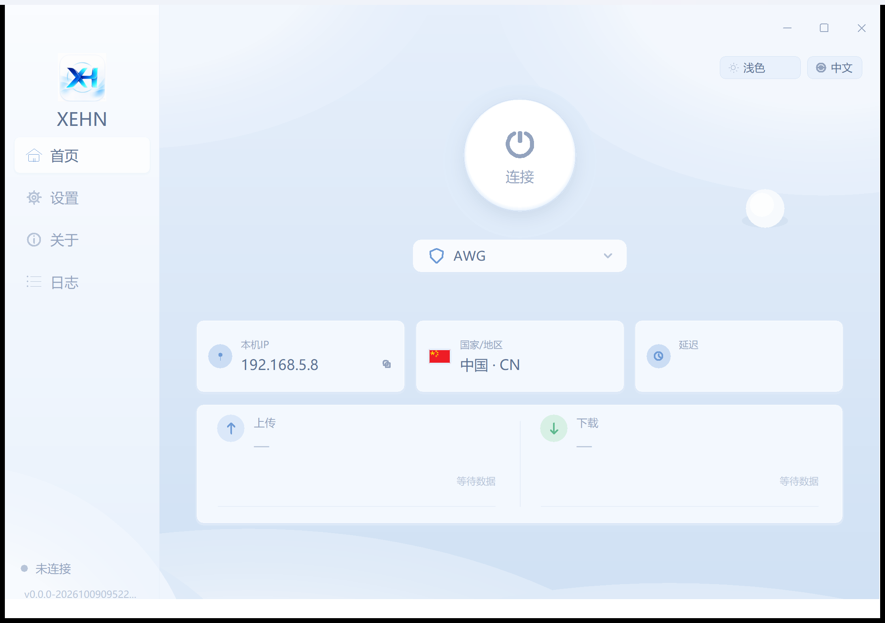
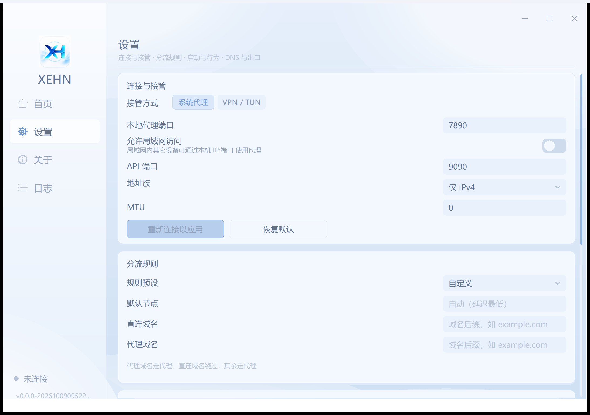
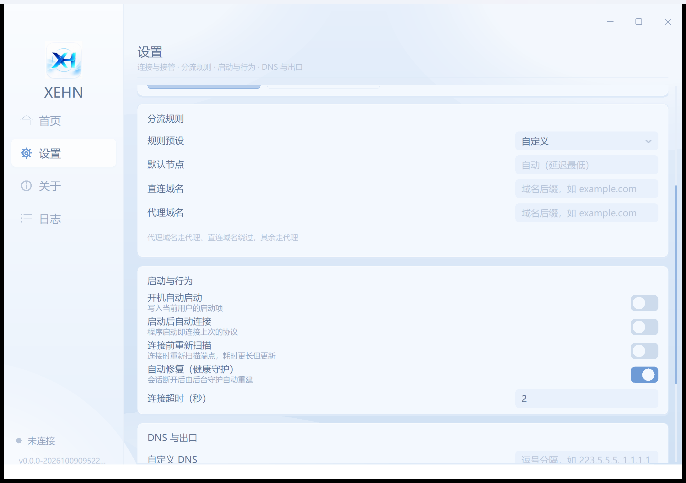
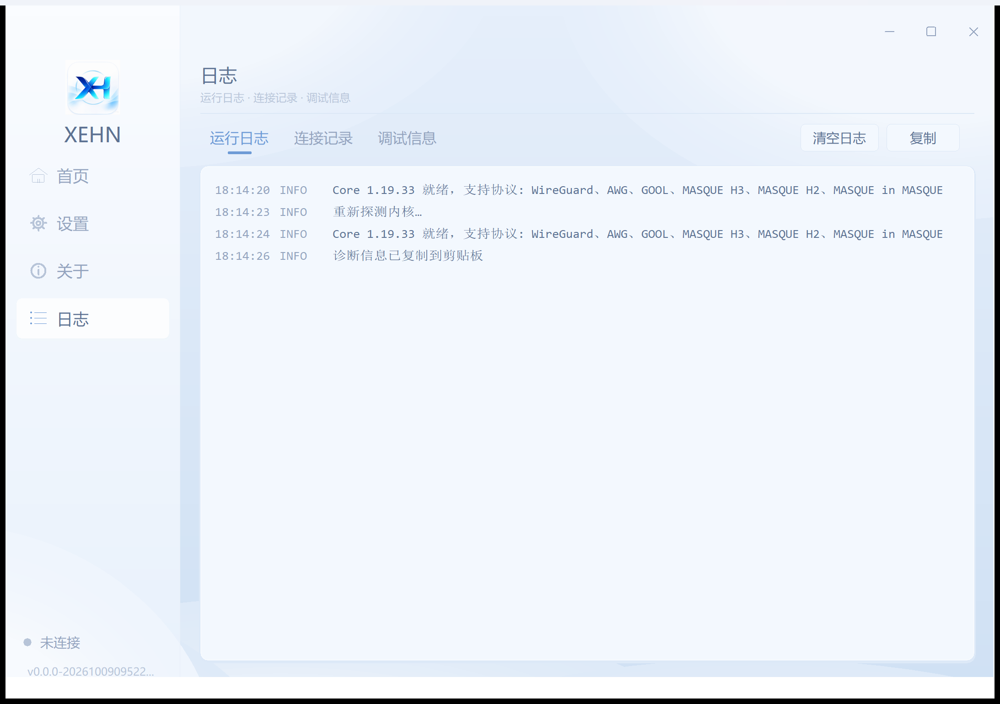
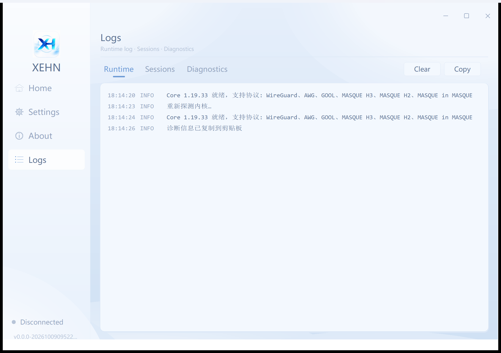

# VEGSH

[English](README.md) | 中文

一个以 Windows 为主的 Cloudflare WARP 客户端：扫描可用端点并一键连接。项目基于 [vernette/warpscout](https://github.com/vernette/warpscout) 的扫描引擎，并使用 [mihomo](https://github.com/MetaCubeX/mihomo) 作为实际流量路由核心。

> **声明**：本软件开源免费，仅供学习交流使用，禁止售卖。程序只在本机配置一条加密隧道，不提供、不代理任何服务器资源。

## 功能特性

| 能力 | 状态 |
|---|---|
| WARP 端点扫描（两阶段探测 + 隧道验证） | 支持（warpscout 引擎） |
| 账号注册 / 轮换 | 支持 |
| AmneziaWG (AWG) | 支持 — `amneziawg-go` 用户态扫描 + mihomo `amnezia-wg-option` 路由 |
| WireGuard | 支持 — mihomo `type: wireguard` |
| MASQUE / MASQUE-H2 | 支持 — mihomo `type: masque` / `network: h2` |
| WARP-in-WARP（嵌套链路） | 支持 — mihomo `dialer-proxy` 链 |
| Psiphon 出口（基础协议 + Psiphon） | 支持 — `psiphon.exe` sidecar，本地 SOCKS |
| OpenVPN 出口（VPN Gate 节点） | 支持 — `--openvpn` 通过 mihomo |
| 出口 IP / 延迟 / 国家显示 | 支持 |
| 扫描结果 + 账号缓存（TTL） | 支持 — `internal/cache` |
| 系统代理模式（默认） | 支持 — WinINET 注册表 + `InternetSetOption` 通知 |
| TUN 全局模式（可选） | 支持 — mihomo `tun:`（需管理员权限；内置 wintun） |
| 原生 GUI（便携版双击运行） | 支持 — Windows 原生窗口（lxn/walk），浅色/深色主题，中文/English |
| 核心分离 / 更新 | 支持 — `core/mihomo.exe` 作为独立文件管理 |
| 便携 ZIP 布局 | 支持 — `pack.ps1` 生成 v2rayN 风格包 |

## 快速开始（便携版）

1. 将压缩包解压到任意可写目录。
2. 双击 `vegsh.exe`，打开原生 GUI 窗口。
3. 点击 **连接**。首次运行时，VEGSH 会自动注册 WARP 账号并扫描最优端点。

ZIP 由干净的 staging 目录组装，**不包含** `warpscout-account.json`、状态、设置、缓存或日志。新设备首次连接/扫描时会注册自己的 WARP 账号。除非你明确要复用该设备身份，否则不要把旧的 `warpscout-account.json` 复制到另一台机器。

### 便携目录结构

```
VEGSH\
├── vegsh.exe             # 唯一程序文件：双击打开 GUI；带参数时作为 CLI
├── core\
│   ├── mihomo.exe        # Clash 核心（可独立替换）
│   ├── psiphon.exe       # 可选：Psiphon 出口 sidecar（GPL-3.0）
│   ├── client.config     # 可选：Psiphon 官方凭据（与 psiphon.exe 成对需要）
│   ├── server_list.dat   # 可选：Psiphon 初始服务器列表
│   ├── geosite.dat       # Geo 数据：“绕过大陆”分流预设需要
│   └── geoip.metadb      # Geo 数据；缺失时首次使用可自动下载
└── README.txt
```

未设置 `WARP_CLIENT_HOME` 时，VEGSH 会将工作目录锚定到可执行文件所在目录（若可写），否则回退到 `%APPDATA%\vegsh`。便携模式下账号、缓存、状态、配置和日志都保存在 exe 同目录。

## 图形界面

`vegsh.exe gui`（或直接双击）会打开基于 [lxn/walk](https://github.com/lxn/walk) 的原生 Windows 窗口。界面通过 `CustomWidgetPixels` 自绘实现——不依赖浏览器、WebView 或运行时 UI 框架，并支持 DPI 缩放。

| 页面 | 内容 |
|---|---|
| **主页** | 连接/断开、会话计时、当前出口（国旗、colo、延迟、上下行）、协议选择、节点详情、实时吞吐图表 |
| **设置** | 接管方式（系统代理 / VPN-TUN、本地端口、局域网访问、API 端口、地址族、MTU）、路由（代理模式、默认节点、分流、域名列表、Geo 分流）、启动/行为、DNS 与出口（Psiphon / OpenVPN 地区） |
| **关于** | 版本、数据/核心路径、许可证、上游项目链接 |
| **日志** | 运行日志、连接历史、诊断信息 |

窗口最下方常驻一个四行日志框：无论当前在哪个页面，都能看到最新的四条日志（含级别标记），点击日志框即可打开「日志」页查看完整历史。

外观：浅色（默认）、深色或跟随系统。语言：**中文（默认）** 或 English。设置保存在 exe 同目录的 `settings.json` 中。

### 截图

| 主页 | 设置 |
|---|---|
|  |  |

| 设置（续） | 日志 |
|---|---|
|  |  |

英文界面：



## 命令行用法

同一个 `vegsh.exe` 同时提供 GUI 和 CLI。带子命令运行时执行 CLI；无参数双击时打开 GUI。

```powershell
# GUI
vegsh.exe
vegsh.exe gui

# 注册 WARP 账号
vegsh.exe register

# 连接（扫描或复用缓存，选择最优端点，启动核心，设置系统代理）
vegsh.exe connect -p awg
vegsh.exe connect -p wg
vegsh.exe connect -p masque
vegsh.exe connect -p masque-h2
vegsh.exe connect --tun            # TUN 全局模式（需要管理员权限）
vegsh.exe connect --scan-now       # 强制重新扫描，忽略缓存

# Psiphon 出口（最终出口 IP 变为 Psiphon）
vegsh.exe connect -p awg --psiphon

# OpenVPN 出口（VPN Gate 节点，IPv4 only；优先于 --psiphon）
vegsh.exe connect -p awg --openvpn
vegsh.exe connect -p awg --openvpn --openvpn-region JP

# 状态 / 列表 / 断开
vegsh.exe status
vegsh.exe list
vegsh.exe list -p wg
vegsh.exe disconnect

# 原始 warpscout 引擎命令仍可用
vegsh.exe scan -best -p awg
vegsh.exe scan -conf - -conf-type mihomo -p awg
```

> Windows 下，由于 GUI 构建使用 `windowsgui` 子系统，`cmd` 可能会在后台 CLI 工作继续运行时先返回提示符；输出仍会附着到调用终端。

## 核心管理

GUI 不内嵌 mihomo，而是将 `core\mihomo.exe` 作为普通文件管理：

- **GUI**：关于页面 → “检查/下载内核”，获取最新 `mihomo-windows-amd64` release。
- **手动**：将任意兼容的 mihomo 构建替换到 `core\mihomo.exe`，无需重新编译。
- **CLI 参数**：`-core PATH` 指定核心二进制路径。

## Psiphon 出口

Psiphon 是**出口**，不是基础协议。`connect --psiphon` 会先建立基础协议，再将 Psiphon 的上游指向本地 SOCKS，并将 Psiphon 作为最终出口——公网出口 IP 变为 Psiphon 的 IP。

所需资源：

| 资源 | 默认位置 | 覆盖方式 |
|---|---|---|
| Psiphon 可执行文件 | `core\psiphon.exe` | `--psiphon-exe` 或 `PSIPHON_EXE` |
| 官方客户端配置 | `core\client.config` 或 `core\psiphon.config` | `PSIPHON_CONFIG` |

`psiphon-tunnel-core` 为 GPL-3.0。它以独立进程运行，不链接进本程序。详见 [THIRD_PARTY_NOTICES.md](THIRD_PARTY_NOTICES.md)。

## TUN 模式

`--tun` 会在 mihomo 配置中添加 `tun:` 块，通过虚拟网卡接管流量，而不是使用系统代理。

- 需要以**管理员身份**运行。
- 随包的 mihomo 构建已内置 wintun，无需额外的 `wintun.dll`。

## 构建

需要 Go 1.26+（模块目标为 `go 1.26.3`）。

```powershell
# 可选：如有需要，设置 Go 模块代理镜像
$env:GOPROXY='https://goproxy.cn,direct'

# 构建 Windows GUI/CLI 二进制
go build -trimpath -ldflags "-s -w -H windowsgui -X main.version=1.0 -X main.windowsGUIBuild=1" -o vegsh.exe .

# 组装便携 ZIP（推荐发布路径）
powershell -ExecutionPolicy Bypass -File .\pack.ps1 [-MihomoPath <mihomo.exe>] [-PsiphonExePath <psiphon.exe>] [-PsiphonConfigPath <client.config>]
```

说明：

- 原生 Windows 窗口需要嵌入在 `rsrc_windows_amd64.syso` 中的 Win32 manifest。`pack.ps1` 会使用 `akavel/rsrc` 从 `app.manifest` 重新生成它。
- `-H windowsgui` 可避免双击时闪现控制台；同一个二进制在带 CLI 参数运行时仍会附着到调用终端。

## 测试

```powershell
go test ./...
```

可选的真实核心集成测试：

```powershell
$env:WARP_TEST_MIHOMO='path\to\mihomo.exe'
go test -v -run TestMihomoAcceptsRenderedConfig .
```

## 架构

```
vegsh (package main)            warpscout 引擎 + 客户端编排层
├── cli.go / flags.go           命令注册与参数接线
├── connect.go                  connect/disconnect/status/list 流程
├── client.go                   mihomo 配置渲染 + 缓存粘合
├── gui*.go                     原生 Windows GUI（walk/canvas）
├── settings.go                 设置模型/加载/保存
├── internal/cache              TTL 缓存（账号 + 扫描结果）
└── internal/core               mihomo sidecar 管理 + 系统代理
```

客户端包含两个核心概念：

1. **AWG/WARP 引擎** — `amneziawg-go` 用户态实现，用于 warpscout 扫描/隧道路径。
2. **Clash 核心** — mihomo sidecar 二进制。VEGSH 写入完整 `config.yaml`，启动核心，通过 external-controller REST API 控制，并将系统流量指向其 mixed port。

## 许可证与第三方声明

本仓库包含或与第三方组件协作，这些组件受各自许可证约束。特别是 mihomo 和 Psiphon 组件为 GPL-3.0。再分发前请查阅 [THIRD_PARTY_NOTICES.md](THIRD_PARTY_NOTICES.md) 和 `third_party/`。本 README 仅为工程说明，不构成法律意见。

## 致谢

- 扫描引擎：[vernette/warpscout](https://github.com/vernette/warpscout)
- Clash 核心：[MetaCubeX/mihomo](https://github.com/MetaCubeX/mihomo)
- AmneziaWG：[amnezia-vpn/amneziawg-go](https://github.com/amnezia-vpn/amneziawg-go)
- Windows GUI 工具包：[lxn/walk](https://github.com/lxn/walk)
- Psiphon Tunnel Core：[Psiphon-Labs/psiphon-tunnel-core](https://github.com/Psiphon-Labs/psiphon-tunnel-core)
